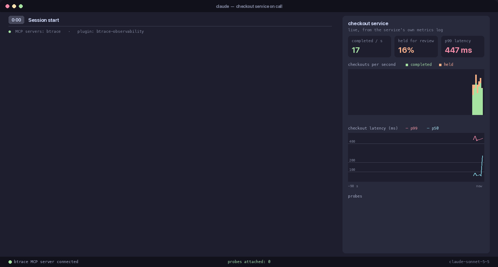

# Demo 06 - Let an AI assistant debug your JVM



*An unedited, real Claude Code session, rendered from its transcript ([session.jsonl](session.jsonl)); the MP4 is next to the GIF.*

**Story.** A checkout service is running. Customers say checkout is sometimes slow, and a lot of
orders end up in manual review, yet there is no fraud spike and nothing in the error logs. The
service cannot be restarted. Instead of typing a BTrace command, you describe the symptom to an AI
coding assistant (Claude Code, Codex or Pi) with the `btrace-observability` plugin installed. It
reads the service source, finds the JVM, deploys narrow probes through the BTrace MCP server, reads
what they printed, and removes each probe before the next.

Nothing in the service code is wrong: a held order is a normal business outcome. Both causes sit
inside a vendor SDK that is shipped as a binary only, so the source explains what `checkout` does
but not what happens inside `PaymentClient` or `FraudScreen`. To see that, the assistant has to
probe the live JVM.

| File | Role |
|---|---|
| `checkout-service/CheckoutServiceApp.java` | the target: four worker threads call `CheckoutService.checkout`, which screens the order with `fraud.screen`. A `Verdict.HOLD` puts the order in a `ReviewQueue` for manual review and returns false. Otherwise it reserves inventory, calls `payments.authorize` and counts the order as completed. It prints a completed count every 5 s and, once a second, a `[metrics] ts=<epoch ms> completed=N held=N p50=MS p99=MS` line for a dashboard scraper |
| `checkout-service/lib/acme-sdk.jar` | a stand-in vendor SDK, binary only on purpose: `PaymentClient` and `FraudScreen` |
| `checkout-service/btrace-permissions.properties` | `allowExtensions=btrace-metrics`: probes may use the bundled metrics extension; `run.sh` and `record-session.sh` pass it with `-Dbtrace.permissions` |
| `vendor/src` | the SDK sources (`PaymentClient`, `FraudScreen`, `RiskServiceException`, `Verdict`), kept for maintainers; rebuild the JAR with `vendor/build-sdk.sh` (needs `JAVA_HOME`) |
| `run.sh` | starts the checkout service with the permissions file and the SDK on the classpath, and leaves it running for a live session |
| `PROMPTS.md` | the rehearsed prompt, what a good answer looks like, and the "Do not record if" rules |
| `record-session.sh` | records a real headless session and renders it |
| `session.jsonl` | the redacted stream-json transcript of the committed recording |
| `metrics.log` | the service's `[metrics]` lines captured during the recording, used by the panel |

Inside the SDK:

- `FraudScreen.screen` sends orders of 500.00 or more through a private `deepScore`, which throws
  `RiskServiceException("deep scoring timed out for order ...")` about half the time. `screen`
  catches it inside the SDK, returns `Verdict.HOLD` exactly as for a suspicious order, and logs
  nothing. Roughly 20-30% of all orders land in manual review for a reason that is not fraud.
- `PaymentClient.authorize` calls the private synchronized `currentSession`. Every 12 calls the
  session expires and the private `refreshSession` takes 300-450 ms while holding the client's lock,
  so all four workers stall behind it and slow `authorize` calls arrive in groups of four. p99
  checkout latency sits around 400-490 ms while p50 is about 50-90 ms.

## Run it live

```sh
export JAVA_HOME=/path/to/jdk-11-or-newer
./run.sh
```

The service needs JDK 11 or newer (it is launched from source, as
`java -cp lib/acme-sdk.jar CheckoutServiceApp.java` in `checkout-service/`). Open your AI host in
`demos/06-ai-assistant/checkout-service` with the plugin installed, then follow
[PROMPTS.md](PROMPTS.md). `run.sh` starts the service with
`-Dbtrace.permissions=checkout-service/btrace-permissions.properties`, so probes may use the
`btrace-metrics` extension. Stop the service with the `kill` command `run.sh` prints.

## Record a session

```sh
AGENT_PLUGINS_DIR=~/src/agent-plugins ./record-session.sh
```

Requirements:

- the `claude` CLI, logged in (`claude auth login`)
- JBang
- a checkout of [btraceio/agent-plugins](https://github.com/btraceio/agent-plugins)
  (`AGENT_PLUGINS_DIR`, default `../../../agent-plugins` relative to this directory)
- `JAVA_HOME` and `BTRACE_HOME` set as for the other demos
- Python 3 with Pillow (`PYTHON` picks the interpreter) and ffmpeg for the MP4

To run the MCP server against a local BTrace build, install the fat agent, which embeds the
extensions, into the local Maven repository. The plain `libs/btrace.jar` has no embedded extensions.

```sh
./gradlew :btrace-dist:fatAgentJar
mvn install:install-file -Dfile=btrace-dist/build/fat-agent/btrace-agent-fat.jar \
  -DgroupId=io.btrace -DartifactId=btrace -Dversion=3.0.0-SNAPSHOT -Dpackaging=jar
```

The model is `DEMO_MODEL` (default `sonnet`). The script copies `CheckoutServiceApp.java`,
`lib/acme-sdk.jar` and `btrace-permissions.properties` into a scratch project directory, starts the
service there with the permissions file, and runs a headless session (`claude -p`) with only the
`btrace-observability` plugin, `--strict-mcp-config` with the BTrace MCP server as the only MCP
server, and only `Read`, `Grep`, `Glob` and the BTrace MCP tools allowed. It sends one prompt, the
`PROMPT` variable in the script (also in [PROMPTS.md](PROMPTS.md)); the prompt already asks the
assistant to leave nothing attached, so there is no follow-up.

Every stream-json event is stamped with the time it was received (`demo_ts`), so the render can line
it up with the service metrics. The raw transcript stays in the demo's log directory. The copy saved
as `session.jsonl` goes through `demos/lib/redact-transcript.py` first: home and temp paths become
`~` and `/tmp`, and JVM listings keep only the processes the session probed or mentioned. The
service's `[metrics]` lines are saved as `metrics.log`. The script then renders
`docs/tutorials/images/06-ai-assistant.gif` and `.mp4` with `demos/lib/render-chat.py ... --metrics
metrics.log`. To re-render without re-recording:

```sh
python3 ../lib/render-chat.py session.jsonl ../../docs/tutorials/images/06-ai-assistant \
  "claude  —  checkout service on call" --metrics metrics.log
```

The renderer shows only what is in the transcript and the metrics log. It shortens long tool
results, folds repeated empty reads, and summarises JVMs on the machine that the session never
probed or mentioned.

## What the panel shows

Next to the chat is a live panel drawn only from recorded data:

- the service's completed and held checkouts per second, and p50 and p99 latency, over the 90 seconds
  before the event on screen
- three headline numbers: completed per second, percent held for review, and p99
- shaded bands while a probe was attached; throughput does not dip under them
- a list of the probes deployed so far, with how long each stayed attached and whether it was removed

A caption above the chat shows the time elapsed since the prompt and the current step, named after
the tool in use (for example "Probing PaymentClient, FraudScreen", "Reading what the probe saw",
"Removing the probe", "Conclusion"). The committed GIF is 1640x880 and about 89 s long (7.2 MB); the
MP4 is 5.9 MB.

## What the committed take shows

The assistant (claude-sonnet-5-5, 20 turns, about 67 s of session time, about 0.27 USD) lists the
JVMs and reads the service source and the permissions file. It tries the shell, which is denied
because the session has no Bash. Its first `deploy_script` fails to compile because it used the 2.x
package `org.openjdk.btrace`; it fixes the imports. It then deploys four probes, each removed before
the next:

1. timing `FraudScreen.screen` and `PaymentClient.authorize` (5 s): about 340 ms `authorize`
   outliers arriving in bursts of four, and HOLD verdicts from the slower screens
2. a short entry trace of all `com.acme.*` methods, to find the SDK internals (6 s)
3. timing the internal methods of `PaymentClient` and `FraudScreen` (12 s)
4. `RiskServiceException` construction, plus `refreshSession` starts and slow `authorize` calls with
   thread names (5 s)

Its conclusion: `refreshSession` takes 311-453 ms about once a second, and the `authorize` calls of
all four workers stall together (for example 268, 302, 303 and 392 ms finishing within about 10 ms,
one per `checkout-0` to `checkout-3`). `deepScore` throws `RiskServiceException` and `screen` turns
it into HOLD: 14 throws matched 14 HOLD verdicts one to one in one window, roughly 1 in 3 to 1 in 4
`deepScore` calls threw, and throws were as fast as successes (10-32 ms against 10-33 ms), so the
"timeout" is not a long call. It states what it inferred rather than measured (the shared lock, from
the pattern; no lock-wait stacks) and suggests vendor follow-ups. It reports every probe removed and
`list_probes` empty.

## Check a take before publishing

The assistant is non-deterministic. Read the transcript against the "Do not record if" rules in
[PROMPTS.md](PROMPTS.md) (scope, leftover probes, printed data, answers given without reading probe
output, causes claimed without evidence) and re-record if any is broken. Check the panel too: the
probe bands should be short and every probe in the list should show as removed.

## Harness cases

`btrace-qe` replays the scenario with three cases in `btrace-qe/cases/demos/06-checkout-*.yaml`:

- `com.acme.payments.PaymentClient::* @return if duration>200ms { print method, duration }`, which
  names `refreshSession`, a private method of a library with no source
- `CheckoutService::checkout @return if duration>200ms { print method, duration }`
- `com.acme.risk.FraudScreen::deepScore @error { print method, stack }`, which shows the private
  `deepScore` throwing inside `screen`, under `CheckoutService.checkout`

The plugin lives in the [btraceio/agent-plugins](https://github.com/btraceio/agent-plugins)
repository. The matching tutorial is [tutorial 05](../../docs/tutorials/05-mcp-server.md).
